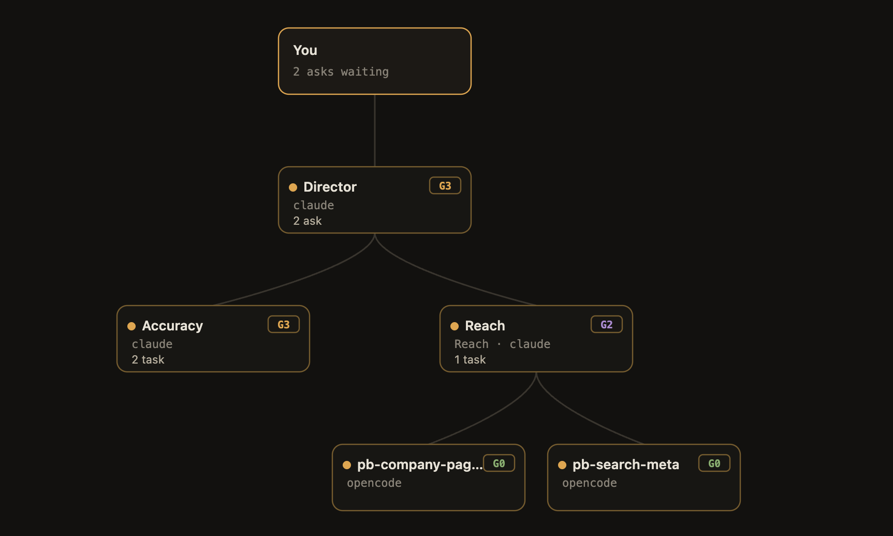
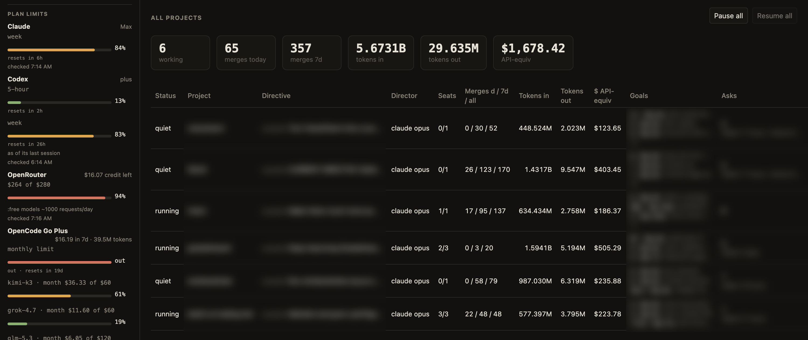
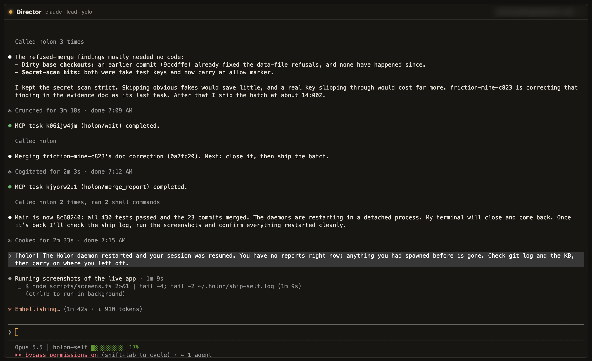

# Holon

**Pool every AI subscription you pay for into one company of agents.** They work together through real terminals.



Holon is a desktop app where AI coding agents run other AI coding agents through real terminals. A Claude Code session reads another terminal's screen, types into it and presses keys, the same way you would. That other terminal can be Codex, OpenCode, a shell, or another Claude. Give a Director a directive and it builds a company under itself: department leads, builders, and a reviewer from another vendor when a decision is risky.

Why terminals? Your Claude Max plan and your ChatGPT plan don't come with API keys; they come with a CLI. So Holon drives the CLI, and each agent runs under the login you already have.

## What 15 days of my subscriptions bought

6 of these companies have been running on my Mac since Oct 21, 2026. One of them builds Holon. This is `node scripts/receipt.ts --since 2026-10-21`; it reads each CLI's own logs, counting the Claude sessions Holon started and the Codex and OpenCode sessions inside its projects:

```
──────────────────────────────────────────────
HOLON RECEIPT                          15 days
2026-10-21 → 2026-11-04 · 6 orgs · 546 merges
──────────────────────────────────────────────
plan                  tokens     at API prices
Claude                 6.93B            $2,078
Free models           809.9M                $0
Codex                 520.6M              $275
OpenCode Go           104.0M               $43
──────────────────────────────────────────────
total                  8.36B            $2,395
──────────────────────────────────────────────
```

That's 8.36 billion tokens on 3 flat-rate plans. 810M of them came from free models: OpenCode's free pool, OpenRouter's `:free` models and a local gateway, which builders use first. When Claude's week runs low, work moves to Codex; when Codex hits its wall, to free models.

Be skeptical of the $2,395. It's what the API would have charged, not what I saved: I'd never have paid that for this work. Most of the tokens are cached context re-read every turn, which is cheap per token and adds up anyway. And 546 merges sounds like more than it is, because plenty of them are small fixes.

Run it on your own machine and post yours. Add `--paid claude=200,codex=20` and it prints what you paid and the multiple.



## The parts

- **Drives any terminal CLI.** Agents act through 6 core tools: `read_screen`, `type`, `press`, `wait`, `spawn` and `list_reports`. That works on any CLI with a terminal UI, so there's no SDK to integrate.
- **Runs orgs, not single agents.** A Director spawns leads, leads spawn builders, and each builder gets its own git worktree. Work comes back through a merge queue that rebases, runs your tests, and fast-forwards only on green.
- **Autopilot.** The org decides for itself. It asks you only for what it can't get: credentials, accounts, money, or something only a person can do (a phone call). Everything else comes back as updates and desktop notifications.
- **Second opinions.** Before a risky move — a non-trivial deploy, secrets, billing, a pivot — the lead asks a read-only reviewer from another vendor. If that vendor is out of quota, the next one takes over.
- **Memory.** An org-wide knowledge base (decisions, facts, lessons, playbooks) outlives every terminal. Passed decisions and your answers get written to it automatically.
- **It watches itself.** A watcher catches stuck menus, quota walls, crashes and prompts nobody answered. Known patterns get fixed by rules; anything odd goes to a free model with secrets scrubbed out first.
- **Model tiers.** Every spawn picks light, standard or heavy (Haiku, Sonnet or Opus on Claude), and free OpenCode models cost nothing. A runway in agent-minutes can shut the org down when it runs out.
- **Traces.** Every run leaves a trace folder. It holds each terminal's screen over time with secrets redacted, the full action log, snapshots of the org chart and per-agent token counts read from each CLI's own logs. `node scripts/trace-report.ts` turns one into a review.

- **Several orgs at once.** Each project gets its own daemon, departments and budget: a daily dollar cap, a run window, and department heads that close when they go quiet and reopen when someone messages them.

The Board shows what the org needs from you and what it shipped. The Map shows the org chart live, with every message travelling between terminals. Click any box to get its terminal full-size.



## What doesn't work yet

The peer mode (a ring of agents with no boss, a shared task board, a critic on every vote) failed my first 4 end-to-end runs. Each failure looked like a new stall, from a silent critic to a 1–1 deadlock to nobody starting work. The cause was mostly me. Read-only seats ran in a permission mode that also blocked their Holon tools, so the auditor could neither vote nor record anything; and a peer that ran out of quota kept its tasks. Since fixing both I've run it 4 more times; runs 5, 7 and 8 passed every check. Run 6 shipped tested code that works; it missed one bookkeeping check because peers closed tasks they never claimed, and Holon now records the finisher as the owner. 3 runs is still a small sample, so it stays marked experimental. The hierarchy with second opinions is the default because it has shipped real work for hours.

A standing council of co-directors from three vendors didn't pay off either. It burned Codex's quota and one co-director overstepped its role twice, so I replaced it with on-demand second opinions.

Other limits:

- macOS only so far, built and tested on Apple Silicon.
- You build it from source; there's no signed release.
- Gemini CLI is supported, but Google no longer allows its Google login for individuals, so it needs a Gemini API key. Without one you can still get Gemini as a reviewer: OpenCode runs it through OpenRouter (`node scripts/e2e-review.ts` does exactly that against a planted bug).
- Agents run with their CLIs' permission prompts skipped by default. Point Holon at a worktree or a throwaway checkout, not your only copy of something.

## Holon builds Holon

Since Oct 21, 2026 one of the orgs running on my machine has had this repo as its directive. It works on a branch called `self`; `node scripts/ship-self.ts` merges that into `main`, runs the tests, restarts every daemon on the new code and rebuilds the app when the UI changed. If a daemon doesn't come back, `main` is reset and the old code restarts. 128 of the 183 commits since then came in through `self`.

It isn't hands-off. Its first version of that script restarted the daemons in the middle of another org's merge (so did mine); it now waits for every merge queue to drain first. I still read what it ships.

## Run it

You need an Apple Silicon Mac, Node 24, git, and one of [Claude Code](https://docs.anthropic.com/en/docs/claude-code) or [Codex](https://github.com/openai/codex) on your PATH and signed in. The Director and department heads use Claude when installed, otherwise Codex. [OpenCode](https://opencode.ai) is optional for builders and reviewers. OpenCode defaults to its own free model without an OpenRouter key. If you have an OpenCode Go subscription, enable **Use my OpenCode Go subscription** in org settings (`opencodeGo: true`). The optional OpenRouter pool needs a key in `~/.config/openrouter/key`.

Builders default to free OpenCode models. If you only have Claude or Codex, untick **Free first** in the org settings so builders can run on your plan. Everything else Holon reads from your machine (Codex and OpenCode usage logs, an OpenRouter key, `prices.json`, `claude-mcp.json`) is optional and skipped when absent.

```bash
git clone https://github.com/ryanfrigo/holon && cd holon
npm install
npm test            # agent CLIs are faked, so this spends no quota; about 2 minutes
npm run app         # builds Holon.app and opens it
```

`npm run app` downloads Electron on the first build (about 100 MB) and leaves the app in `apps/desktop/dist/mac-arm64/`. The app runs its daemon from this checkout, so don't move or delete the folder after building. You don't start the daemon yourself: the app launches one per project and finds it again when you reopen it.

Then, in the app: add a project and point it at a git repo, type a directive in the sidebar, press **Start org**. Start small: "add a README" beats "rebuild the billing system". The Director appears on the Map within a few seconds, and the Board fills as it works.

After a day or two, `node scripts/receipt.ts` prints your own receipt. It reads only local files and sends nothing anywhere.

### No display, or no app

The daemon and everything it does run without Electron:

```bash
npm run daemon &                                   # listens on a unix socket, logs to stdout
node scripts/start-org.ts ~/code/some-repo "add a README"
node scripts/status.ts                             # every project's seats, asks and commits
```

`start-org.ts` makes the same call as **Start org**. It needs one of Claude Code or Codex installed and signed in; the Director uses Claude when installed, otherwise Codex. Stop the daemon with `kill %1`; the org's seats are saved and come back on the next start. The org is saved in `~/.holon`, so if you build the app later it opens that project, named after the repo.

`HOLON_HOME` moves the daemon's files and socket. `HOLON_SOCKET`, if set, wins over it: leave it unset unless you mean it.

A first run with no Claude login is fine. The Plan limits panel shows "not signed in" under Claude and nothing else changes; it checks again on the next look, so signing in fixes it without a restart.

## How it fits together

```
apps/desktop      Electron app: Board, Map, Terminals (React + xterm.js)
packages/core     daemon: terminals (node-pty + headless xterm), org, merge queue,
                  knowledge base, watcher, traces, usage
packages/mcp      the tools a lead gets, served over MCP to its own CLI
scripts/          end-to-end runs with real agents, and the trace report
```

Each agent CLI gets its tools from Holon's MCP server, launched by the CLI itself. Calls go over a unix socket to the daemon, tagged with the caller's terminal id. A lead can only touch its own reports. The daemon refuses the rest.

The end-to-end scripts use real agents and real quota. `scripts/e2e-drive.ts` has a Claude lead drive a Claude or Codex builder through a small task; `scripts/e2e-org.ts` runs two builders in parallel worktrees through the merge queue.

## License

MIT. See [LICENSE](LICENSE).
